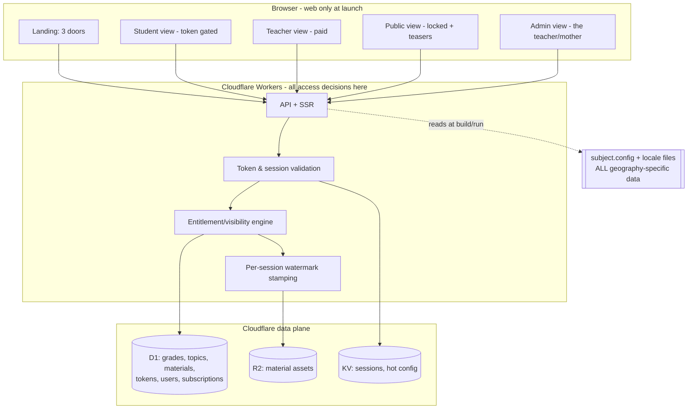

# Architecture Overview

Status: **Phase 0 — proposed, pending gate approval.** No code written yet.

## Guiding constraints (from the brief)

1. **Student experience first; real content last.** Build the machine on sample data.
2. **Server-side access control is the floor.** No security by UI-hiding.
3. **Subject-agnostic.** Nothing about "geography" in application logic, styling, or copy.
   A reviewer should `grep -ri geograph` and find hits only in config/content.
4. **i18n-ready from day one.** Romanian-only at launch, English as an additive content phase.
5. **Free-first.** Default to free tiers; flag-and-ask before anything paid.

## Recommended stack (Cloudflare-first, validated below)

| Concern | Choice | Free-tier fit at launch (≤30 students) |
|---|---|---|
| Hosting / frontend | **Cloudflare Pages** | Free, generous |
| Backend / API & access control | **Cloudflare Workers** | Free (100k req/day) — far above need |
| Relational data | **Cloudflare D1** (SQLite) | Free (5 GB, generous reads) |
| File/asset storage | **Cloudflare R2** | Free (10 GB, **no egress fees**) |
| Hot cache / sessions | **Cloudflare KV** | Free tier sufficient |
| Web framework | **React Router v7 (Remix)** on Workers (ADR-0004) | Free |
| ORM / migrations | **Drizzle ORM** (typed, D1-native) | Free |
| Video streaming | **Cloudflare Stream** — **DEFERRED** to late phase | Paid; not used yet |
| AI features | **DEFERRED** to late phase, kept separate | Paid; not used yet |
| Payments | **Netopia** — **DEFERRED** (TBD), starts at teacher phase | Fees only when money moves |

### Cloudflare fit check (per §7.0 — validate, don't assume)

- **Server-side access control** → Workers + D1 is an excellent fit. ✅
- **Relational taxonomy (grade → topic → material) + tokens** → D1 is a clean fit. ✅
- **Asset storage (written lessons, photos, slideshows, exam PDFs)** → R2, no egress cost. ✅
- **⚠️ Cloudflare Access is NOT the right tool for our auth.** Access is Zero-Trust SSO
  for internal apps; our students use anonymous shared tokens and our teachers/public need
  custom subscription gating. We implement auth ourselves in Workers + D1. (See ADR-0001.)
- **⚠️ Video (later):** Cloudflare Stream fits and gives signed, time-limited, watermark-friendly
  playback — but it is the **first real cost** (see `costs.md`). Decided at the video phase.
- **⚠️ AI retrieval (later):** Workers can call an external LLM API + a vector store
  (Cloudflare Vectorize) fine; the open question is *privacy of her materials*, not feasibility.
  Deferred and revisited as its own phase.
- **Worker CPU limits:** our request paths (auth check, list materials, sign a media URL) are
  short and well within Workers limits. Any future long-running job (bulk import, AI batch)
  goes to Workers **Queues**/cron, not the request path. Flagged, not a blocker.

**Verdict:** Cloudflare fits every *current-phase* requirement at **$0/month**. The only pieces
needing a paid decision are deferred (video, AI, payments), and each is gated on your sign-off.

## High-level shape

## Engine vs. content (the reusability seam)

- **Engine (never subject-specific):** roles, tokens, sessions, access/entitlement rules,
  payments, AI plumbing, UI components, theming system.
- **Content + config (the only thing that changes per subject):** `subject.config`
  (name, branding, theme, grade range, taxonomy, enabled material types), locale message
  files (all UI strings), and seed data (sample/real materials).

Swapping content must never touch engine code. Enforced by ADR-0003 and proven in Phase 8.

## Environments

- **Local dev** → Wrangler (Cloudflare's local emulator) with local D1/R2/KV. Free.
- **Preview** → Pages preview deployments per branch. Free.
- **Production** → Pages production. Free until video/AI/payments turn on.
