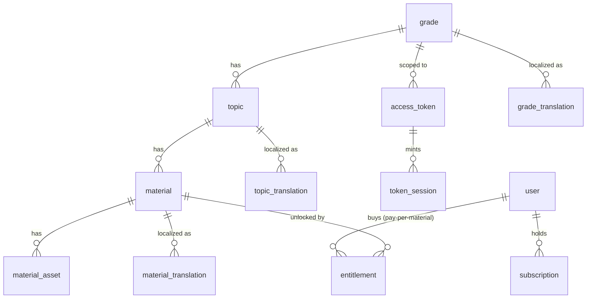

# Data Model

Status: **Phase 0 — proposed.** Designed for: extensible material types, i18n-readiness,
subject-agnostic reuse, and token-only students (no student PII).

## Design principles

- **No geography anywhere.** Subject name, taxonomy labels, and material types come from
  `subject.config` + seed data, not from schema or code.
- **i18n by separation.** Human-readable text is never stored on the core row; it lives in
  `*_translation` rows keyed by `locale`. Launch seeds `ro`; adding `en` later is additive.
- **Extensible material types.** A material's `type` is a string key registered in config
  (`material_types`), not a hardcoded enum in code. Adding a type = config + a renderer.
- **Token-only students.** Students are anonymous. No student table, no student PII.

## Entities

### Taxonomy

**`grade`** — a level (9–12 for geography today, but range is config-driven)
- `id`, `position` (sort), `slug`, `is_active`
- `cycle` — optional grouping key (e.g. `liceu` = 9–12)
- text in `grade_translation(grade_id, locale, label)`

**Cycle grouping (browse display, config-driven).** Each cycle in `subject.config.cycles`
carries a `display: 'grouped' | 'expanded'` flag, so a future subject can group several grades
under one collapsed entry if it wants to. The geography instance currently defines a single
cycle, *liceu* (9–12, `expanded`) — grades 5–8 (*gimnaziu*) were dropped from the taxonomy
entirely (2026-08-26): the platform now only teaches liceu. Cycles only affect how the catalog
is presented and are fully subject-agnostic (another subject can define its own cycles or none).

**`topic`** — subject/topic within a grade
- `id`, `grade_id` (FK), `position`, `slug`, `is_active`
- text in `topic_translation(topic_id, locale, label, description)`

### Materials (extensible + dual-library)

**`material`**
- `id`, `topic_id` (FK), `type` (string key from config `material_types`)
- `library` — `'student'` | `'teacher'` (the two separate libraries from §3/§6)
- `position`, `slug`, `status` (`'draft'` | `'published'`)
- `is_teaser` (bool) — if true, visible to the public role as a free teaser
- `created_at`, `updated_at`
- text in `material_translation(material_id, locale, title, body_richtext, description)`

**`material_asset`** — binary payloads (images, slideshow files, exam PDFs, later video refs)
- `id`, `material_id` (FK), `locale` (nullable = locale-agnostic asset), `role` (e.g. `'cover'`)
- `r2_key`, `mime`, `bytes`, `checksum`
- Files live in **R2**; DB stores only references. Streaming URLs are signed at request time.

> **Extensibility:** the `type` string maps to a config entry describing its label, icon,
> the render component, and (later) its ingest schema. New type = add a config entry + a
> renderer component + (optionally) an ingest skill. No schema migration required.

### Access & tokens (student path)

**`access_token`** — the shared per-class string
- `id`, `token_hash` (we store a hash, never plaintext), `label` (e.g. "Clasa 6A 2025–2026")
- `scope_type` = `'grade'` (designed to allow `'material'`/`'topic'` later without migration)
- `scope_id` → `grade.id`
- `issued_by` (admin user id), `valid_from`, `valid_until` (default **15 June**), `revoked_at`
- `created_at`

**`token_session`** — minted when a student enters a valid token
- `id`, `token_id` (FK), `watermark_code` (per-session, stamped onto delivered content)
- `created_at`, `expires_at` (short-lived, e.g. a few hours; renewable while token valid)
- Carried to the client as a **signed, httpOnly cookie / signed token**, validated server-side
  on every material request against `scope`. (Stored hot in KV for fast validation.)

### Accounts (teacher / public / admin — later phases, modeled now)

**`user`**
- `id`, `email`, `password_hash` (or provider id), `role` (`'admin'` | `'teacher'` | `'public'`)
- `locale_pref`, `created_at`, `status`
- Students are **not** users.

**`subscription`** / **`entitlement`** (later)
- `user_id`, `tier` (`'teacher'` | `'teacher_pedagogy'` | `'public_sub'`), `status`, `period_end`
- `entitlement(user_id, material_id)` for public **pay-per-material** purchases
- Provider (Netopia) fields added at the payments phase (TBD).

## ERD

## i18n readiness checklist (satisfies §7.0 + ADR-0002)

- [x] Every label/title/body is in a `*_translation` row keyed by `locale`.
- [x] `locale` is a first-class field; launch seeds `ro`; `en` is additive.
- [x] No UI string is hardcoded — all come from locale message files (engine) or translations (content).
- [x] Content (translation rows, assets) is separated from presentation (renderers, theme).

## Subject-agnostic checklist (satisfies §10 + ADR-0003)

- [x] Grade range, taxonomy, subject name, branding, theme, enabled material types → `subject.config`.
- [x] Schema contains zero subject literals.
- [x] Seed data is per-instance; clearing/replacing it never touches engine code.
